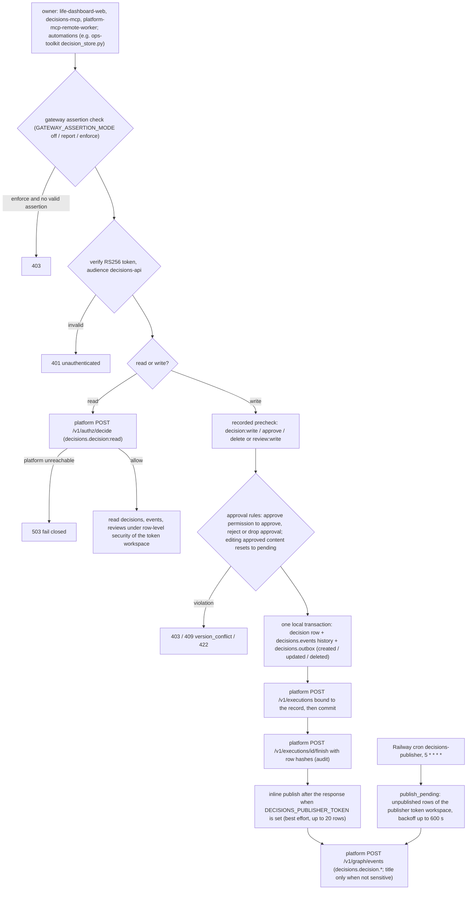

# 01 — Business process (As-Is / To-Be)

life-decisions-api คือ cell ที่เก็บบันทึกการตัดสินใจ (decision) พร้อมเหตุผล หลักฐาน ประวัติการเปลี่ยนแปลง และวันทบทวน (review) ของ owner ผู้เรียกคือ owner ผ่าน `life-dashboard-web`, `decisions-mcp`, hosted tool hub และ automation ที่ถือ token ของ `empire-platform`; สิทธิ์ การบันทึก execution/audit และ graph ทำผ่าน `empire-platform` ด้วย token ของผู้เรียก

Last reviewed: 2026-11-27 · commit `e9941b7`

## As-Is (จากโค้ดวันนี้)

Sources: `src/solo_decisions/app.py` (`write`, `record_event`, `emit`, `publish_soon`, routes `/v1/decisions*`, `/v1/decision-events`, `/v1/decision-reviews*`), `src/solo_decisions/auth.py` (`AUDIENCE`), `src/solo_decisions/gateway.py` (`GatewayCheck.from_env`), `src/solo_decisions/publisher.py`, `src/solo_decisions/platform.py`, `.railway/railway.ts`, `migrations/0001_decisions.sql`, `README.md`

ข้อเท็จจริงสำคัญจากโค้ด:

- review (`PUT /v1/decisions/{id}/reviews/{due_date}`, `PATCH /v1/decision-reviews/{id}`) ผ่าน write path เดียวกันและมี audit (`decisions.review.created|updated|unchanged`) แต่ไม่เขียน outbox: graph ได้เฉพาะ event ของ decision
- event ชนิด state (`created`, `approved`, `updated` ฯลฯ) มาจาก write เท่านั้น; append ตรงที่ `/v1/decisions/{id}/events` ใช้เพิ่ม note และทุก event บันทึก `authenticated_actor` จาก token
- privacy class → classification: `internal` → internal, `private` → confidential, `sensitive` → restricted (ไม่ส่ง title)
- ไม่มี job ใดในโค้ดที่ตรวจ review ที่เลยกำหนดหรือส่งการเตือน
- `GATEWAY_ASSERTION_MODE` ค่าเริ่มต้น `off`; ค่าที่ใช้ใน production [ต้องยืนยัน]

## To-Be (จาก `PRODUCT.md` §Measures และ §Capabilities)

- review ที่เลยกำหนดและยัง pending: เป้า 0
- decision ที่รออนุมัติเกิน 7 วัน: เป้า [ต้องยืนยัน: owner target]
- แถว outbox ที่ยังไม่ publish หลัง 1 ชั่วโมง: เป้า 0
- 5xx และ p95 latency ของ `/v1/decisions` (Sentry และ uptime worker)
- out of scope: ทำ action ของ decision เอง และการส่งการเตือน review [ต้องยืนยัน: ต่อกับ notifications cell หรือไม่]

ไม่มี diagram To-Be ของกระบวนการใน repo (`specs/001-l2-baseline/spec.md` เป็นงาน tooling/tests ไม่เปลี่ยนพฤติกรรม)

## Gap

| ID | As-Is → To-Be | Status | Owner | Evidence |
|---|---|---|---|---|
| G1 | ไม่มีอะไรตรวจหรือเตือน review ที่เลยกำหนด → review เลยกำหนดที่ยัง pending เป็น 0 | decide | owner | `PRODUCT.md` §Measures และ §Capabilities (reminders out of scope [ต้องยืนยัน]) |
| G2 | ไม่มีตัววัดอายุแถว outbox ที่ค้าง; sweep รันชั่วโมงละครั้ง (`5 * * * *`) และ backoff สูงสุด 600 s → 0 แถวค้างเกิน 1 ชั่วโมง | todo | claude | `PRODUCT.md` §Measures; `.railway/railway.ts`; `src/solo_decisions/publisher.py` |
| G3 | ยังไม่มีเป้าของ decision ที่รออนุมัติเกิน 7 วัน → owner กำหนดเป้า | decide | owner | `PRODUCT.md` §Measures [ต้องยืนยัน: owner target] |
| G4 | ไม่มี To-Be ของกระบวนการที่เขียนไว้ (diagram หรือ spec) → owner กำหนด | decide | owner | ไม่มีใน `PRODUCT.md` / `specs/` |

## Open questions

- `PRODUCT.md` §Operating Context บอกว่า `decisions-publisher` รันทุก 15 นาที แต่ `.railway/railway.ts` และ `README.md` เป็น `5 * * * *` (ชั่วโมงละครั้ง): ควรแก้ `PRODUCT.md` หรือเปลี่ยน schedule
- `GATEWAY_ASSERTION_MODE` ใน production เป็น `report` หรือ `enforce` [ต้องยืนยัน]
- automation ใดเขียน decision อยู่จริงวันนี้ (`PRODUCT.md` ระบุ [ต้องยืนยัน])
